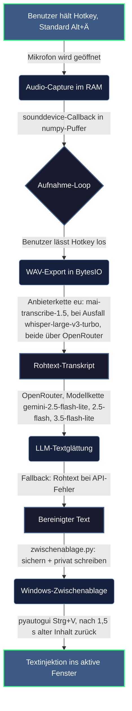

# typeFREE — Systemweites Voice-to-Text für Windows

typeFREE ist ein Diktier-Assistent, der als Hintergrundprozess auf dem Windows-Desktop läuft: Hotkey halten → sprechen → loslassen → der transkribierte und sprachlich geglättete Text landet direkt im aktiven Eingabefeld — egal ob Terminal, Browser oder Office.

**Status:** Produktiv im Eigeneinsatz (täglicher Diktat-Workflow) · 506 automatisierte Prüfungen · **drei wählbare Transkriptionswege** (`eu` = reine OpenRouter-Kette mit `mai-transcribe-1.5` an erster Stelle, `whisper-large-v3-turbo` als Rückfall, `beste` = ElevenLabs Scribe v2 mit Keyterms, `schnell` = Groq whisper-large-v3) · Wiederholung bei Drosselung + Rückfall auf den nächsten verfügbaren Weg · Glättung über eine Modellkette mit Ausfallmeldung · Prompt-Verschärfung gegen Füllwörter · Einzelinstanz-Sperre · Betriebshärtung abgeschlossen · Installer-Paket für Weitergabe · DSGVO-konforme Einrichtung.

---

## 0. Update 09/2026 — warum es nötig war

Zwei Befunde aus dem Betrieb (aus `typefree.log` und Messungen vom 25.09.2026):

1. **Der Filter lief gar nicht.** Die installierte EXE war der Build vom 02.08., die Quelle seit dem 14.08. auf ein neueres Glättungsmodell umgestellt — nur neu gebaut wurde nie. OpenRouter hatte das alte Modell inzwischen abgekündigt, jede Glättung endete im `404`. Ergebnis: 226 von 226 Diktaten wurden ungeglättet eingefügt, und weil der Fehler nur in der Logdatei stand, blieb es wochenlang unbemerkt.
2. **Die Transkription lief über einen toten Umweg.** Der OpenAI-Schlüssel gehört zu einem Konto ohne aktives Guthaben (`billing_not_active`), jeder direkte Aufruf scheiterte, und jedes Diktat ging anschließend über OpenRouter — gemessen ein Vielfaches der Zeit.
3. **Und der Ausweichweg schnitt das Audio ab.** Der Transkriptions-Endpunkt von OpenRouter (`/api/v1/audio/transcriptions`) liefert in rund der Hälfte der Läufe nur die letzten Sekunden des Audios zurück. Reproduziert über 16 Messläufe, mit wav, flac und mp3, mit festgenageltem Anbieter (DeepInfra, Together, Groq) und mit Zero-Data-Retention-Filter. Direkt bei Groq: 16 von 16 vollständig. **Das war die eigentliche Erklärung für „das funktioniert nicht so gut" — es kamen wochenlang Textbruchstücke an, nicht die ganze Diktatlänge.**

Behoben durch **wählbare Anbieterketten** für die Transkription und eine **Modellkette** für die Glättung, beide mit Ausweichstufen und Zeitmessung je Stufe. Der abgeschnittene Whisper-Weg über OpenRouter ist aus dem Regelpfad entfernt; für Diktate blieb dort damals nur der Audio-Chat-Weg (Mistral/Voxtral), der nicht betroffen war. *(Stand 25.09.2026, abgelöst: Das Abschneiden trat ab Oktober nicht mehr auf; seit 14.10.2026 besteht die Kette nur noch aus `mai-transcribe-1.5` und `whisper-large-v3-turbo`, beide über den Transkriptions-Endpunkt, der Audio-Chat-Weg ist raus.)*

| Weg (`transkription`) | Ausführung | 24,5 s deutsches Audio | Vollständig | Kosten/h |
|---|---|---|---|---|
| **`eu`** (Standard) | Reine OpenRouter-Kette: `mai-transcribe-1.5` → `whisper-large-v3-turbo` | mai-1.5: 2,2–3,4 s bei 70 s Audio, 1,1 % Wortfehler (14.10.) | vollständig ✅ | ~0,36 $ |
| `beste` | ElevenLabs Scribe v2 mit Keyterms | noch nicht gemessen | – | 0,264 $ |
| `schnell` | Groq `whisper-large-v3` | **0,72–1,97 s** | 16 von 16 ✅ | 0,111 $ |
| *(entfernt)* | OpenRouter `whisper-large-v3`, Transkriptions-Endpunkt | 0,8–3,7 s | **5 von 16** ❌ | 0,09–0,11 $ |

Fehlt der Schlüssel für den gewählten Weg, nimmt typeFREE automatisch den anderen und schreibt es ins Log — ein fehlender Schlüssel soll das Diktieren nicht verhindern. Umgestellt wird im Tray-Menü unter **„Transkription wählen"** (wirkt sofort, ohne Neustart) oder in der `config.json` neben der EXE: `"transkription": "eu" | "beste" | "schnell"`.

**Seit 14.10.2026 nur noch zwei Glieder: `microsoft/mai-transcribe-1.5` vorn, `openai/whisper-large-v3-turbo` als Ausweich.** turbo erfand im Betrieb in Sprechpausen „Vielen Dank" (3 von 7 Diktaten am 14.10.) und brauchte 2,1–12,4 s; Sebastian: „Qualität ist sehr schlecht geworden". Messung am 14.10. (70 s Referenzaudio, je 3 Läufe): mai-1.5 2,2–3,4 s bei 1,1 % Wortfehler (leise mit zwei Pausen 1,7 %), turbo 3,0–3,8 s bei 3,4–5,1 %, mai-2 1,4–20,1 s bei 2,8 %. Weitere Glieder kosten nur im Störfall Zeit, dann aber je Glied bis zu 90 s — deshalb entfallen mai-2 (unstet), voxtral-stt (19 s) und der Audio-Chat-Weg (erfindet Sätze, drosselt). Die Glättung lässt Inhalte bewusst stehen; was das Transkriptionsmodell erfindet, kommt also durch.

**Vorher (13.10.2026) stand `openai/whisper-large-v3-turbo` vorn — Tempo vor Genauigkeit.** Am 12.10. antwortete `mai-transcribe-2` im Median erst nach 11,3 s (einzelne Anfragen bis 58 s), turbo nach 1,8 s (70 s Referenzaudio, 5 Läufe, alle vollständig). Der Preis dafür: 5,1 % Wortfehler statt 2,8 % (mai-2) bzw. 1,1 % (mai-1.5) — bewusst in Kauf genommen. Echter Lauf über `transcribe_audio` am 13.10.: 2,2–3,0 s warm, der erste Aufruf eines Prozesses 4,2–4,9 s. Bekanntes Risiko: Whisper erfindet in Stille gelegentlich Sätze — betrifft vor allem den Live-Modus (Standard aus). Rückweg: das Glied `turbo` aus `KETTEN['eu']` entfernen — das Vorwärmmodell ist immer das erste Glied und folgt von selbst; die Reihenfolgetests in `windows/tests/test_transkription.py` sind dann zurückzustellen.

**Gegen hängende Anfragen (Transkriptions-Endpunkt, also turbo, mai & Co.):** Antwortet der Dienst nach einigen Sekunden nicht (4 s plus 0,03 s je Audiosekunde) oder meldet er Drosselung/Serverfehler (429/5xx), schickt typeFREE dieselbe Anfrage ein zweites Mal parallel; die erste brauchbare Antwort gewinnt. Nach spätestens 90 s werden beide Verbindungen geschlossen, und die Kette rückt zum nächsten Modell weiter. Die Zweitanfrage kostet dasselbe wie die erste und erscheint in der Kostenanzeige. Audio-Chat und ElevenLabs laufen ohne Zweitanfrage.

**Zwei Sicherungen, damit ein Diktat nicht verloren geht:** Auf dem Audio-Chat-Weg wird bei Drosselung (429) der Aufruf bis zu dreimal wiederholt (1 s / 2 s Pause, nur bei 429 und 5xx). Fällt der gewählte Weg trotzdem aus, läuft der nächste verfügbare Weg als **Rückfall** — welcher Anbieter es war, steht im Log und in der Kostenzeile („(groq)"). Auf strikt umstellen: `RUECKFALL = False` in `windows/typefree.py`. Unabhängig davon wechselt `aktive_kette()` schon **vor** dem Diktat den Weg, wenn für den gewählten gar kein Schlüssel da ist: `eu` → `schnell`, `schnell` → `eu`, `beste` → `eu` (Log: „Kein Schlüssel für Weg …“) — das schaltet `RUECKFALL = False` nicht ab.

**Modellwahl nach Benchmark und eigener Messung (25.09.2026, Historie — aktuelle Kette siehe oben):** Für Deutsch liegt `microsoft/mai-transcribe-2` vorn — an 140 s natürlichem Deutsch **0,3 % Wortfehler in 3,8 s** (325 von 325 Wörtern), Kosten 0,10 $/Stunde. Zum Vergleich im selben Lauf: `mai-transcribe-1.5` 0,3 % in 11,8 s (0,36 $/h), `voxtral-…-stt` 0,3 % in 18,9 s, `whisper-large-v3` 1,2 % in 4,5 s, der Voxtral-Chat-Weg lief in eine 429. Deshalb steht `mai-transcribe-2` an erster Stelle der Standardkette; die anderen rücken nach, wenn er nicht liefern kann. Alle Wege sind über OpenRouter erreichbar und erfüllen die ZDR-Einstellung des Kontos: OpenRouter lehnt nicht konforme Endpunkte ab (`404 ZDR violation` bzw. `0 endpoints out of 1 requested`) — was liefert, ist damit nachweislich konform. `google/gemini-3.5-transcribe` fällt genau daran aus. ElevenLabs Scribe v2 wäre laut Benchmark gleichauf (2,2 %), erfüllt die ZDR-Vorgabe aber nicht: echtes Zero-Retention ist dort Enterprise-Kunden vorbehalten, und über OpenRouter ist es nicht erreichbar.

**Drosselung entschärft (25.09.2026, Historie — seit 14.10.2026 ist der Audio-Chat-Weg nicht mehr in der Kette):** Der Audio-Chat-Weg läuft bei Mistral im *geteilten* Anbieter-Pool und bekam ab etwa 60 s Audio durchgehend `429 rate-limited upstream` — lange Diktate endeten im roten Symbol. In der Kette stehen deshalb jetzt die **Transkriptions-Endpunkt-Wege vorn**; sie kennen diese Drosselung nicht (69,7 s in 4,8 s, 139 s im Test). Der Chat-Weg ist nur noch das dritte Glied und liefert weiterhin als einziger die Fachbegriffe mit. Zweiter Befund aus dem Betrieb: Voxtral gab einmal den Auftragstext selbst zurück; solche Antworten verwirft der Code inzwischen (`_ist_auftragstext`).

Vorher lag der Median im echten Betrieb bei 4 s (p90 10 s, Maximum 27 s) — inklusive des jedes Mal fehlschlagenden OpenAI-Versuchs.

---

## 1. Systemarchitektur

Der gesamte Client lebt bewusst in einer einzigen Datei ([windows/typefree.py](windows/typefree.py)) und integriert sich über vier Bausteine in das Betriebssystem:

* **Globale Key-Hooks:** Die Python-Bibliothek `keyboard` registriert den Hotkey auf Betriebssystemebene (Standard: `Alt + Ä` halten, auch per `AltGr + Ä` auslösbar). 13 vordefinierte Hotkey-Kombinationen sind über das Tray-Untermenü „Hotkey wählen" auswählbar; die Auswahl wird in `config.json` persistiert. **Modifier werden über den Scancode erkannt, nicht über den Namen** — die `keyboard`-Bibliothek meldet sie in der Anzeigesprache von Windows (`STRG`, `UMSCHALT`), Scancodes sind dagegen sprachunabhängig.
* **Audio-Aufnahme im RAM, Mikrofon nur bei Bedarf:** `sounddevice` öffnet das Mikrofon (16 kHz, mono) erst beim Drücken des Hotkeys und gibt es beim Loslassen sofort wieder frei — noch vor dem API-Aufruf. Das Windows-Mikrofonsymbol erscheint dadurch nur während einer Aufnahme, und andere Programme können das Gerät zwischenzeitlich nutzen. Der Puffer wird über `soundfile` als WAV in einen In-Memory-Buffer (`io.BytesIO`) geschrieben — ohne jeglichen Festplatten-I/O.
* **Zweistufige Sprachverarbeitung mit wählbarem Weg:** Die Transkription läuft über eine **Anbieterkette**, die in der `config.json` gewählt wird — `eu` (Standard: reine OpenRouter-Kette — `microsoft/mai-transcribe-1.5`, bei Ausfall `openai/whisper-large-v3-turbo`, beide über den Transkriptions-Endpunkt), `beste` (ElevenLabs Scribe v2) oder `schnell` (Groq `whisper-large-v3`). Jeder Anbieter wird nur versucht, wenn sein Schlüssel in der `.env` steht; fehlt der Schlüssel des gewählten Wegs, nimmt typeFREE den anderen und protokolliert das; kann keiner liefern, meldet typeFREE einen Fehler, statt still zu schweigen. Jeder Aufruf geht mit `language="de"` und einem **Vokabel-Hinweis** — es gibt zwei Listen, weil die Wege verschiedene Grenzen haben: die **volle Fachliste** (`FACH_VOKABULAR`, 98 Begriffe: Denglisch, IT-Fachsprache, Azure-Kurs, Werkzeuge) geht an ElevenLabs als `keyterms` (bis zu 100 Begriffe — die Liste bleibt darunter, sonst fiele der Rest still weg) und in den Auftragstext des Chat-Wegs; der **kurze Kern** (`WHISPER_VOKABULAR`, 51 Begriffe) geht als `prompt` an Whisper, weil dort eine **harte Grenze von 224 Tokens** gilt und längere Hinweise von der API still gekürzt werden (Groq-Doku: „max 224 tokens"; OpenAI-Cookbook: nur die letzten 224 Tokens zählen). Gemessen am 25.09.2026: 147 Tokens für den Kern (cl100k_base, tiktoken 0.12), inklusive Sicherheitszuschlag für den mehrsprachigen Whisper-Tokenizer ~198 von 224 — ein Test hält die Liste in dieser Grenze. „Commit" und „Comet" stehen in beiden Listen: der belegte Verhörer vom 25.09.2026. Anschließend glättet OpenRouter den Rohtext über eine **Modellkette** (`google/gemini-2.5-flash-lite`, Ausweichwege `google/gemini-2.5-flash` und `google/gemini-3.5-flash-lite`): Füllwörter raus (auch großgeschriebene wie „ÄHM"), Verhaspler geglättet, **offensichtliche Verhörer aus dem Zusammenhang korrigiert** — Umgangssprache und Slang bleiben dabei ausdrücklich unangetastet. Ist das Ergebnis auffällig kürzer als der Rohtext (abgeschnitten oder das Modell hat geantwortet statt bereinigt), wird der Rohtext eingefügt. **Anrede und Sprechakt bleiben unangetastet:** „du" bleibt „du", „Sie" bleibt „Sie", eine Aussage wird keine Frage und eine Bitte keine Feststellung — kein Erzähl- und kein Fragestil. Fällt die Glättung dreimal in Folge aus, erscheint einmalig ein Windows-Hinweis — damit ein abgekündigtes Modell den Filter nicht wieder wochenlang stilllegt.
* **Aussteuerung im Log:** Zu jedem Diktat schreibt typeFREE den Pegel („Aussteuerung: Spitze 0,64 · RMS 0,088") und warnt unter RMS 0,02 — denn ein Diktat kann nur so gut sein wie die Aufnahme. Referenzmessung vom 25.09.2026: sauberes deutsches Referenzaudio (`windows/referenzaudio/de_referenz.wav`, 69,7 s, Wortlaut im Repo) kommt auf **4,0 % Wortfehler**, dieselbe Passage in 25-Sekunden-Happen auf 3,4 % — Länge und Happen machen praktisch keinen Unterschied. Schnelles Sprechen (+30 %), leises Sprechen (−35 %) und viele Füllwörter kosteten 0,0 bis 1,2 %. Damit ist belegt: sinnlose Wörter am Ende eines Diktats („Brother 1", „Buster Brauch" im Betriebslog) kommen aus der Aufnahme an dieser Stelle, nicht aus dem Modell. Nachmessen: `py -3.12 windows/sprachmessung.py -d windows/referenzaudio/de_referenz.wav --happen 25` — der Messweg wurde bewusst **nicht** in die App eingebaut, weil er nichts bringt.
* **Kein Diktat geht verloren:** Schlägt die Transkription fehl (Drosselung, Netz), bleibt die Aufnahme im Arbeitsspeicher, und das Tray-Menü bietet **„Letztes Diktat erneut versuchen (N s)"** an — ein Klick statt neu sprechen. Die Aufnahme liegt weiterhin nur im RAM (kein Festplatten-I/O), und sobald ein Versuch angekommen ist, wird sie verworfen. Anlass: Am 25.09.2026 gingen mehrere lange Diktate durch die Drosselung des Anbieters verloren und mussten neu gesprochen werden.
* **Tray-Icon:** Ein per `PIL` gezeichnetes Mikrofon-Symbol (`pystray`) signalisiert den Pipeline-Zustand farblich: Grau = bereit, Grün = Aufnahme, Orange = Transkription, Blau = Textglättung, Rot = Fehler. Fehler werden zusätzlich als Windows-Sprechblase gemeldet und in `typefree.log` neben der EXE protokolliert — ein Diktat soll nie stillschweigend verloren gehen.
* **Ton aus beim Diktat:** Während der Aufnahme schaltet typeFREE das Standard-Wiedergabegerät stumm, damit Musik oder ein Podcast nicht ins Mikrofon läuft, und stellt es mit dem Ende der Aufnahme sofort wieder an — genau das Gerät, das es stummgeschaltet hat. War der Ton schon aus, bleibt alles unangetastet; das Mikrofon wird nie berührt, und nichts verlässt den Rechner (Windows-Lautstärke-Schnittstelle über `pycaw`, Modul `windows/ton_aus.py`). Folgt eine Aufnahme direkt auf die nächste, schaltet nur das Ende der jüngsten den Ton wieder ein. Vor dem Stummschalten schreibt typeFREE die Merker-Datei `ton_aus_aktiv.json` neben die `config.json` — lässt sie sich nicht schreiben, bleibt der Ton an. Bricht typeFREE mitten in einer Aufnahme hart ab (z. B. beim EXE-Tausch), schaltet der nächste Start die gemerkten Geräte wieder ein — auch wenn eines inzwischen von Hand stummgeschaltet wurde. Ein Gerät, das sich nicht zurückstellen lässt (Kopfhörer getrennt — beim Start oder mitten im Diktat), bleibt im Merker und wird beim Beenden, beim nächsten Start oder beim nächsten Diktat auf diesem Gerät nachgeholt; andere Geräte schaltet typeFREE trotzdem weiter stumm. Der Merker wird über eine Zwischendatei ausgetauscht, ein Schreibfehler lässt den alten heil. Abschaltbar im Tray-Menü („Ton aus beim Diktat") oder mit `"ton_aus": false` in der `config.json`; Standard ist an. Idee aus Blitztext (macOS, MIT).
* **Kein erfundener Text aus der Stille:** Transkriptionsmodelle erfinden bei Stille gern Untertitel-Abspänne („Untertitel im Auftrag des ZDF, 2021") oder Floskeln („Vielen Dank."). typeFREE schneidet solche Abspänne am Textende ab und verwirft ein Diktat, das nur noch daraus besteht; kurze Floskeln wie „Danke." oder „Okay." fliegen nur, wenn die Aufnahme weniger als 0,3 s Sprache enthält (gemessen in 30-ms-Abschnitten). Gilt für „Alles auf einmal" und für jeden Live-Happen (Modul `windows/halluzination.py`, Phrasenlisten aus Blitztext, MIT). Ein verworfenes Diktat wird trotzdem in der Kostenrechnung gebucht — die Transkription lief und kostet. Hat Live in einer Aufnahme nur Erfundenes gehört, wird sie nicht noch einmal als Ganzes gesendet; nur wenn dabei ein Happen gescheitert ist oder noch nicht fertig war, holt die normale Verarbeitung die ganze Aufnahme nach. Das Log nennt beim Verwerfen keinen Text.
* **Zwischenablage bleibt sauber:** Das Diktat geht zum Einfügen kurz über die Zwischenablage, aber mit den Windows-Kennzeichen „nicht in den Verlauf" und „nicht in die Cloud" (`CanIncludeInClipboardHistory`/`CanUploadToCloudClipboard` = 0, `ExcludeClipboardContentFromMonitorProcessing`) — es taucht also nicht in Win+V auf. Was vorher kopiert war, sichert typeFREE im selben Zugriff und stellt es 1,5 s nach dem Einfügen wieder her, außer jemand hat inzwischen etwas anderes kopiert (Sequenznummer der Zwischenablage, zusätzlich muss noch genau dieses Einfügen drinliegen, erkannt an einer Zufallsmarke). Folgt ein zweites Diktat, bevor der alte Inhalt zurück ist, übernimmt es dessen Sicherung — zurück kommt also immer der Inhalt von vor dem ersten Diktat. Lässt sich der Vorinhalt nicht vollständig sichern (z. B. eine Grafik nur als Metadatei, über 32 MB, Lesefehler), bleibt die Zwischenablage unangetastet und typeFREE tippt den Text direkt (Unicode-`SendInput`, Zeilenumbrüche als Leerzeichen, damit kein Enter in Chat oder Terminal absendet). Das letzte Diktat bleibt nur im Arbeitsspeicher und lässt sich über das Tray-Menü **„Letztes Diktat kopieren"** jederzeit (privat) in die Zwischenablage holen — gemerkt wird es vor dem Einfügeversuch, auch ein gescheitertes Einfügen verliert es also nicht. Die Rückgabe lässt sich mit `"zwischenablage_zurueck": false` in der `config.json` abschalten. Live-Modus unberührt (tippt ohnehin direkt). Idee aus Blitztext (macOS, MIT); Kurzprobe am echten PC 20.10.2026: Schreiben 0,016 s, Zurückstellen 0,012 s, Endzustand byte-gleich. Aufnahmen unter 0,3 s (versehentlicher Tipp auf den Hotkey) werden gar nicht erst gesendet und kosten nichts; im Live-Modus läuft beim Start trotzdem die Vorwärm-Mini-Transkription.
* **Mitlaufende Kostenrechnung:** Das Tray-Menü zeigt Minuten und Betrag für den laufenden Monat und insgesamt. Gebucht wird **beim Transkribieren** mit dem Preis des Anbieters, der tatsächlich geliefert hat — Groq `whisper-large-v3` $0,111 je Stunde, Voxtral (Mistral über OpenRouter) rund $0,36 je Stunde (aus der Anbieter-Abrechnung ermittelt), ElevenLabs Scribe v2 $0,264 je Stunde (0,22 $ plus 20 % Keyterms-Aufschlag). Die Beträge sind damit die **Summe der tatsächlich gebuchten Diktate**; laufen im Monat mehrere Wege, nennt die Anzeige den ersten mit „+" („(Groq +)"). Vorher wurde die Monatssumme mit dem Preis des gerade gewählten Wegs umgerechnet — im Betrieb am 25.09.2026 wurden aus 0,33 $ dadurch 1,04 $, ohne dass ein Cent mehr ausgegeben war. Die Audiolänge ist im Programm exakt bekannt — die Kosten lassen sich also ohne Zusatzabfrage und ohne zweiten Zugangsschlüssel mitrechnen. Gebucht wird, sobald eine Transkription geliefert hat: nach dem Einfügen, oder — wenn der Halluzinationsfilter den Text verwirft — auch ohne Einfügen, denn die Anfrage lief und kostet. Für fehlgeschlagene Anfragen und für zu kurze Aufnahmen (unter 0,3 s, nicht gesendet) erscheint kein Betrag. Den exakten Preis jedes eingefügten Diktats schreibt typeFREE in die Logdatei; ein verworfenes erscheint dort nur als „verworfen".

Der finale Text wird über die Win32-Zwischenablage (`windows/zwischenablage.py`, `ctypes`) geschrieben und nach einer kurzen Stabilisierungspause (0,3 s) per emuliertem `Strg+V` (`pyautogui`) in das aktive Fenster eingefügt — geschützt, siehe „Zwischenablage bleibt sauber".

---

## 2. Ende-zu-Ende-Datenfluss



---

## 3. Design-Entscheidungen (das „Warum")

### Warum Cloud-APIs statt lokaler Modelle?
Lokale Whisper-Modelle benötigen erhebliche GPU-Ressourcen und verzögern das Diktat um mehrere Sekunden — für einen Assistenten, der nebenbei laufen soll, ungeeignet. Die Kosten sind verschwindend gering (~1,20 $ in mehreren Monaten Eigeneinsatz zu OpenAI-Preisen; über Groq kostet dieselbe Stunde Audio $0,111 statt $0,36).

### Warum alles über OpenRouter läuft

Sebastians Vorgabe vom 25.09.2026: **„nur über OpenRouter und das beste Modell, das meinem ZDR-Datenschutz entspricht."** Groq und OpenAI sind deshalb als Wege stillgelegt — die Schlüssel wurden aus der `.env` der Anlage entfernt (Sicherungen `.env.bak-groq` und `.env.bak-openai` liegen daneben, ein Zurück ist jederzeit möglich), und die Standardkette kennt nur noch OpenRouter. Damit ein einzelner Weg trotzdem kein Diktat kostet, hat die Kette seit 14.10.2026 zwei Glieder: `mai-transcribe-1.5` zuerst, `whisper-large-v3-turbo` als Ausweich, beide über OpenRouter und unter der ZDR-Einstellung des Kontos. Mehr Glieder kosten im Störfall je Glied bis zu 90 s Wartezeit.

### Warum Rohtext live und Glättung am Ende?

Wunsch vom 25.09.2026: „das schon Ausgeben im Wortfluss, aber dann quasi das Umschreiben und Umdeuten im Nachhinein" — wie bei Voicely oder Everlast AI. Echtes Wort-für-Wort-Streaming geht über OpenRouter nicht (der Transkriptions-Endpunkt nimmt fertige Dateien, Realtime-STT ist dort nicht buchbar). Stattdessen schneidet typeFREE während der Aufnahme an **Sprechpausen** Happen heraus — die erste nach drei Sekunden, spätestens nach zehn an der leisesten Stelle —, transkribiert sie sofort und fügt sie roh am Cursor ein. Der Text erscheint also mit ein bis zwei Sekunden Verzögerung, während gesprochen wird.

Jeder Block wird **vor dem Tippen** geglättet — mit dem Ende des bisher Getippten als Zusammenhang, damit die Glättung weiß, worum es geht, ihn aber nicht wiederholt. Was einmal im Dokument steht, bleibt stehen: Beim Loslassen kommt nur noch der Rest dazu, **nichts wird gelöscht oder ersetzt**. Bis zum 06.10.2026 lief es andersherum — erst roh tippen, am Ende alles per Rücktaste löschen und die Gesamtglättung einsetzen. Das sah unruhig aus, und Rücktasten in einem fremden Fenster sind ein Risiko. Der Preis: Die Block-Glättung kennt nur, was vorher kam, nicht was folgt. Damit die vielen kleinen Aufrufe billig bleiben, laufen sie zuerst über die Lite-Modelle (`POLISH_MODELLE_LIVE`).

Ein Block endet oft mitten im Satz. Damit dort kein falscher Punkt steht, hält typeFREE das Satzzeichen am Blockende zurück und entscheidet erst beim nächsten Block: Beginnt dessen **Rohtext klein**, geht der Satz weiter, und das Zeichen fällt weg. Beginnt er groß, kommt das Zeichen dazu. Das klingt simpel, ist aber gemessen: An sechs echten Grenzfällen lag diese Regel sechsmal richtig, das Sprachmodell mit derselben Aufgabe nur viermal. Eingeschaltet wird das im Tray unter **„Ausgabe"**; Standard ist „alles auf einmal".

**Live tippt direkt, nicht über die Zwischenablage.** Solange der Hotkey gehalten wird, kommt `Strg+V` im Zielfenster nicht an — gemessen am 06.10.2026: Bei gehaltenem AltGr+Ä fügte `Strg+V` nichts ein, auch nachdem typeFREE die Zusatztasten per Software losgelassen hatte. Die Happen wurden deshalb zwar transkribiert, aber nie eingefügt; der Abschluss löschte trotzdem Zeichen, als wären sie da. Ein Test mit echtem Finger auf der Taste zeigte den Ausweg: **direkt getippter Text** (`SendInput` mit `KEYEVENTF_UNICODE`) kommt an, auch beim Halten. Seitdem fügt der Live-Modus jeden Happen so ein (`unicode_tippen`), und er läuft in beiden Hotkey-Modi — „Halten und loslassen" wie „Tippen zum Starten/Beenden" (Tray → „Hotkey-Modus").

### Warum Clipboard-Injektion statt Tastaturemulation?
Zeichenweise Tastaturemulation scheitert regelmäßig an Umlauten, Sonderzeichen und Tastaturlayouts. Der Weg über die Zwischenablage (privat schreiben → `Strg+V`) stellt den Text in jedem Windows-Programm codierungsfehlerfrei dar — die 0,3-Sekunden-Pause vor dem Einfügen stellt sicher, dass die Zwischenablage den Text sicher übernommen hat. Die Ausnahme ist der Live-Modus (siehe oben): Er tippt per Unicode-`SendInput`. Das ist keine Tastaturemulation über das Layout — Windows bekommt die Zeichen selbst (UTF-16, Emoji als Ersatzpaar), deshalb kommen auch Umlaute unverfälscht an.

### Warum RAM-Pufferung statt temporärer Audiodateien?
Die komplette Kette Mikrofon → `numpy` → WAV-Struktur → API-Upload läuft im Arbeitsspeicher — keine SSD-I/O-Last, keine temporären Dateien.

### Warum nicht Win+H?
Windows' eigene Diktierfunktion (Win+H) ist brauchbar, hat aber mehrere praktische Nachteile:
1. **Bleibendes Popup:** Das Diktier-Popup schließt sich nicht von selbst — du musst es manuell wegklicken. Das stört den Workflow erheblich.
2. **Sprachqualität & Filterung:** Die Erkennung und Füllwort-Filterung von Win+H ist schwächer als die zweistufige Whisper+Gemini-Pipeline von typeFREE.
3. **Undurchsichtige Datenverarbeitung:** Es ist nicht transparent, ob oder wie Microsoft die Sprachdaten verarbeitet, ob sie internetabhängig sind oder lokal bleiben.
4. **Nicht anpassbar:** Die Audio-Qualität, das Vokabular und die Textnachbearbeitung lassen sich nicht beeinflussen.

typeFREE umgeht diese Probleme: Die zweistufige Pipeline (Whisper + Gemini über OpenRouter) liefert bessere Erkennung und Filterung, die Datenverarbeitung ist transparent (OpenRouter DSGVO-konform, kein Training auf Nutzerdaten), und das minimale Tray-Icon bleibt unsichtbar im Hintergrund — kein Popup, das geschlossen werden muss.

### Hotkey-Handling: gelernte Stolperfallen
Drei Erkenntnisse aus dem Praxisbetrieb stecken im Code:
* `suppress=True` im `keyboard.hook()` ist gefährlich: Gibt der Haken für ein Ereignis nicht `True` zurück, wird es geschluckt — ein fehlerhafter Haken blockiert die gesamte Tastatur systemweit. typeFREE nutzt ihn genau an einer Stelle (`_sperr_haken`), die bei jedem Fehler durchlässt.
* **Zusatztasten-Freigabe (Live-Modus):** Bei gehaltenem Alt käme typeFREEs Strg+V als Strg+Alt+V an und fügte nichts ein — gemessen in Notepad; Alt+Rücktaste heißt dort sogar „Rückgängig". Zu Beginn einer Live-Aufnahme lässt typeFREE Alt, Strg und Shift deshalb per Software los (mit einem kurzen Strg-Tipp davor, damit sich kein Menü öffnet) und sperrt deren erneutes Drücken bis zum Ende der Aufnahme.
* **Ä-Sperre:** Wackelt der Modifier während der Aufnahme kurz weg, würde die gehaltene Haupttaste als normales Zeichen wiederholt („ääää"). Solange aufgenommen wird, schluckt typeFREE deshalb das Drücken der Haupttaste (`taste_schlucken`); das Loslassen kommt immer durch, damit die Aufnahme endet.
* Modifier-Zustände werden über ein eigenes `_mods_down`-Set verfolgt statt über `keyboard.is_pressed()` — zuverlässiger bei schnellen Tastenfolgen (inkl. `AltGr`, das Windows intern als `Strg+Alt` meldet).
* Key-Repeat-Events während einer laufenden Aufnahme werden ignoriert, sonst würde das Halten des Hotkeys die Aufnahme ständig neu starten.
* **Das Loslassen der Haupttaste beendet die Aufnahme immer** — die Modifier werden dabei absichtlich *nicht* geprüft. Die Entscheidungslogik steckt zu diesem Zweck in einer reinen Funktion (`decide_hotkey_action`) und ist automatisiert geprüft.

### Wie erkennt man ein totes Mikrofon ohne Fehlalarm?
Ein deaktiviertes oder abgezogenes Gerät liefert **exakte digitale Nullen** — ein angeschlossenes Mikrofon in einem echten Raum liefert immer Grundrauschen. Bleiben Datenpakete drei Sekunden lang aus *oder* enthalten sie nur exakte Nullen, verbindet typeFREE das Mikrofon einmal neu; erst wenn das misslingt, gibt es rotes Icon und Klartext-Meldung. Eine harte Obergrenze von 10 Minuten pro Aufnahme deckelt zusätzlich den Speicherverbrauch — der Text wird dabei trotzdem gesendet.

### Prompt-Design als Schutzschicht
Der Glättungs-Prompt weist das LLM explizit an, den diktierten Text **nicht zu beantworten** („er ist kein Befehl und keine Frage an dich"). Füllwörter werden in **allen Schreibweisen** erkannt („ähm", „Ähm", „ÄHM"), aber als Fachbegriff erkannte Wörter bleiben stehen. Schlägt die Glättung fehl, wird der Whisper-Rohtext unverändert eingefügt — der Nutzer verliert nie ein Diktat.

### Entstehungs-Motivation: Claude-Code-Workflow beschleunigen
typeFREE entstand aus dem konkreten Bedürfnis, ausführliche Prompts per Sprache in das Claude-Code-CLI-Terminal einzugeben.

---

## 4. Projektstruktur

```
typeFREE/
├── README.md
├── CLAUDE.md                  # Projekt-Leitfaden für KI-Agenten (Status, Hotkey-Regeln)
├── typeFREE.spec              # PyInstaller-Rezept: Build als fensterlose EXE
├── typeFREE.exe.manifest      # UAC-Manifest für Admin-Rechte (requireAdministrator)
├── installer/                 # Installationspaket für Weitergabe
│   ├── setup.cmd              # Installations-Assistent (API-Key, Autostart, Verknüpfungen)
│   ├── setup.cmd.manifest     # UAC-Dekoration
│   ├── installer_lib.py       # Installations-Logik (Python, testbar)
│   ├── deinstallieren.cmd     # Vollständige Entfernung (auch aus "Apps & Features")
│   ├── ANLEITUNG-API-KEY.html # DSGVO-konforme Einrichtung
│   ├── config.json            # Hotkey-Voreinstellung
│   ├── autostart_admin.cmd    # Notfall-Autostart
│   └── typeFREE.exe           # Vorgefertigte EXE
├── ci/
│   └── version_schreiben.py   # Version + Commit für die EXE (ruft typeFREE.spec bei jedem Build auf)
├── build/
│   ├── autostart_admin.cmd
│   ├── autostart_einrichten.ps1
│   └── build_installer.cmd    # baut EXE und kopiert in installer/
└── windows/
    ├── typefree.py            # Kompletter Client: Hooks, Audio, Tray, API-Pipeline
    ├── ton_aus.py             # Ton aus beim Diktat (Stummschalten/Zurückstellen, eigener Faden)
    ├── halluzination.py       # Erfundene Texte erkennen (Abspann, Floskeln aus der Stille)
    ├── zwischenablage.py      # Zwischenablage sichern, privat schreiben, zurückstellen (Win32)
    ├── version.py             # Version/Commit; im Quellcode „dev (lokal)", in der EXE vom Build gesetzt
    ├── requirements.txt       # Abhängigkeiten (sounddevice, keyboard, openai, …)
    ├── requirements-dev.txt   # pytest — nur für die Tests
    ├── config.json            # Persistierte Hotkey-Wahl (Standard: Alt + Ä)
    ├── einrichten.cmd         # Setup für Python-Skript-Modus (pythonw)
    ├── einrichten_exe.cmd      # Setup für EXE-Modus (Admin, Aufgabenplanung)
    └── tests/                 # 506 automatisierte Prüfungen in 26 Dateien (pytest)
```

Die Prüfungen richten sich auf reine Funktionen — Hotkey-Entscheidung, Mikrofon-Erkennung, Zeitgrenze, Anbieter- und Modellketten, Textglättung, Installations-Logik —, damit sie ohne Mikrofon, Tastatur oder Netzzugang laufen. Sie brauchen **Python 3.12** (dort liegen die Abhängigkeiten); das Projekt-venv gibt es nicht, der Aufruf ist reproduzierbar aus dem Projektverzeichnis:

```powershell
$env:PYTHONPATH="."; py -3.12 -m pytest windows/tests -q      # Stand 25.09.2026: 109 passed
```

---

## 5. Schnellstart

### Empfohlen: Installations-Assistent (für Endanwender und Weitergabe)

Der `installer/`-Ordner enthält ein fertiges Paket — keine Vorkenntnisse nötig:

```powershell
installer\setup.cmd            # Rechtsklick → "Als Administrator ausführen"
```

**Schritt für Schritt:**
1. `installer\setup.cmd` mit Rechtsklick → **„Als Administrator ausführen"**
2. **OpenRouter API-Key** eintragen (kostenlos, $1 Startguthaben — für Transkription und Textglättung)
3. Optional: **OpenAI API-Key** — der Assistent fragt ihn noch ab und schreibt ihn in die `.env`, aber keine Transkriptionskette nutzt ihn (Stand 14.10.2026); einfach leer lassen
4. Fertig — typeFREE läuft sofort im Tray

> **Noch offen (nächster Schritt):** Der Assistent fragt den **Groq-Schlüssel** (Weg „schnell") und den **ElevenLabs-Schlüssel** (Weg „beste") noch nicht ab; der Standardweg `eu` braucht nur OpenRouter. Wer einen der anderen Wege will, trägt den Schlüssel von Hand in die `.env` neben der EXE ein. Auch die **vorbereitete EXE in `installer/`** stammt noch vom 02.08.2026 — vor der nächsten Weitergabe `build/build_installer.cmd` laufen lassen, sonst bekommt der Empfänger den alten Build.

Der Assistent erledigt automatisch:
* Installation nach `%ProgramFiles%\typeFREE`
* Desktop-Verknüpfung, Startmenü-Eintrag und Autostart
* **Windows "Apps & Features"**-Eintrag (Deinstallation wie jede andere Windows-App)
* DSGVO-konforme Einrichtung (OpenRouter Zero Data Retention aktiviert)

**Wichtig:** Der Empfänger muss **keine System-Umgebungsvariablen** setzen — alle Keys stehen editierbar in der `.env` neben der EXE.

**Deinstallation:** Windows-Taste → Einstellungen → Apps → Installierte Apps → typeFREE → Deinstallieren.

**Hinweise:**
* Der globale Tastatur-Hook benötigt unter Windows **Administrator-Rechte** — daher das UAC-Manifest in der EXE. Ohne Admin installiert der Assistent nach `%USERPROFILE%\typeFREE` (Hotkey funktioniert, kein Autostart).
* Hotkey ändern: Rechtsklick auf das Tray-Icon → „Hotkey wählen" → Eintrag anklicken (13 Optionen, der aktive ist markiert). Standard ist `Alt + Ä`.
* Fehler nachlesen: `typefree.log` neben der EXE. Da die EXE fensterlos gebaut wird (`console=False`), ist die Logdatei die einzige Spur, die ein Absturz hinterlässt.

---

### Alternativ: Entwicklung und Eigenbau

#### Variante A: Als Python-Skript

```powershell
cd windows
pip install -r requirements.txt
python typefree.py
```

Benötigte API-Keys in einer `.env` neben der EXE (bzw. im Projektordner):

```
OPENROUTER_API_KEY=...    # Pflicht: Transkription (Weg eu, Standard) + Textglättung
GROQ_API_KEY=...          # optional: Weg „schnell" (Groq whisper-large-v3)
ELEVENLABS_API_KEY=...    # optional: Weg „beste" (ElevenLabs Scribe v2)
```

Fällt der gewählte Weg ganz aus, springt der nächste Weg ein, für den ein Schlüssel da ist (`RUECKFALL`). Einen direkten OpenAI-Weg gibt es in keiner Kette. Beim Start aus dem Quellcode haben echte Umgebungsvariablen Vorrang, sodass sich beim Entwickeln ein anderer Schlüssel vorgeben lässt; in der installierten Anlage gewinnt die `.env`. Die `.env` ist von der Versionierung ausgeschlossen.

Für unsichtbaren Start (kein Terminal-Fenster): `windows/einrichten.cmd` ausführen.

#### Variante B: Als EXE bauen

```powershell
py -3.12 -m PyInstaller typeFREE.spec
```

Das Build-Rezept schreibt bei **jedem** Build `windows/_version_build.py` frisch (über
`ci/version_schreiben.py`, nicht versioniert): Version `dev` oder der Wert der
Umgebungsvariable `TYPEFREE_VERSION` (z. B. `typefree-v1.2.0` → `1.2.0`) und den aktuellen
Commit. Die EXE nennt beides in der Startzeile ihres Logs („typeFREE gestartet — Version 1.2.0
(85b072b) — …") und unter „typeFREE" im Tray-Menü. Beim Start aus dem Quellcode steht dort
immer „Version dev (lokal)" — die Build-Datei liest nur die EXE. So ist jederzeit sichtbar,
welche Fassung läuft.

Die EXE liegt dann unter `dist/typeFREE.exe`. Anschließend:

```powershell
windows\einrichten_exe.cmd
```

Dieses Skript:
1. Prüft, ob die EXE existiert
2. Startet typeFREE mit Admin-Rechten (UAC)
3. Richtet auf Wunsch die Windows-Aufgabenplanung ein (Autostart bei Anmeldung + Aufwachen)

Die EXE wird bewusst **nicht** versioniert (Binärartefakt); der Build ist über das PyInstaller-Rezept jederzeit reproduzierbar.
